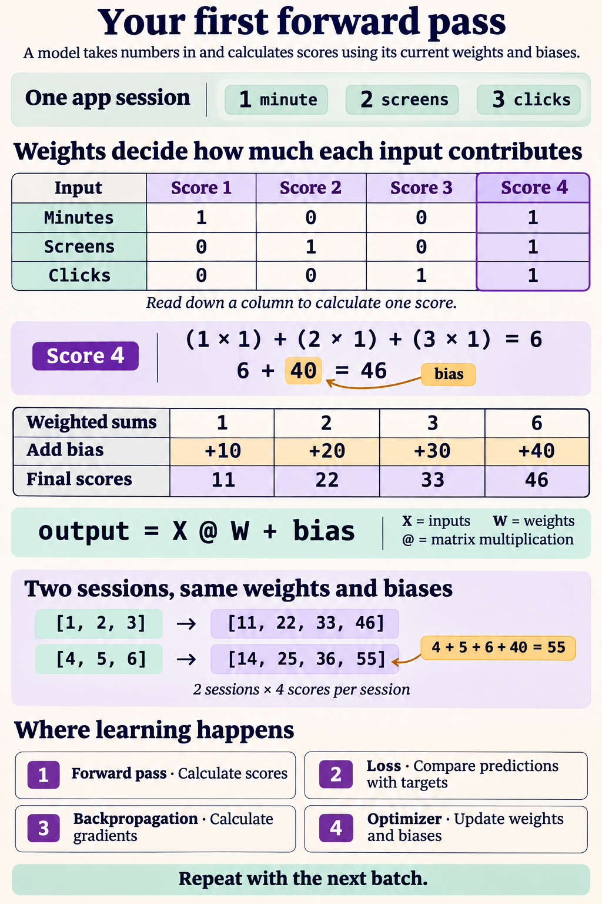
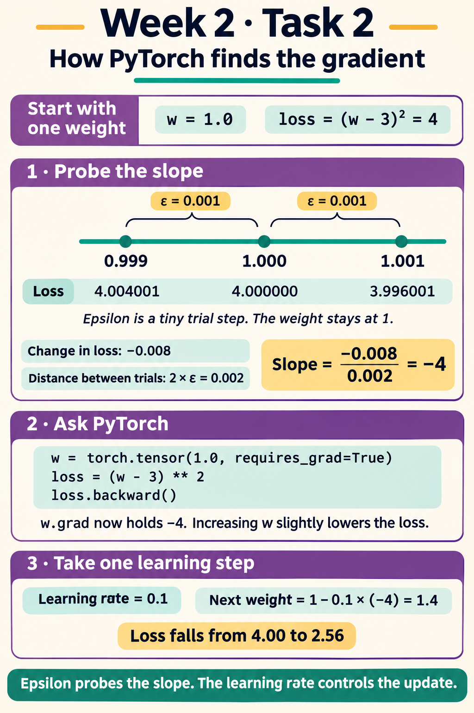
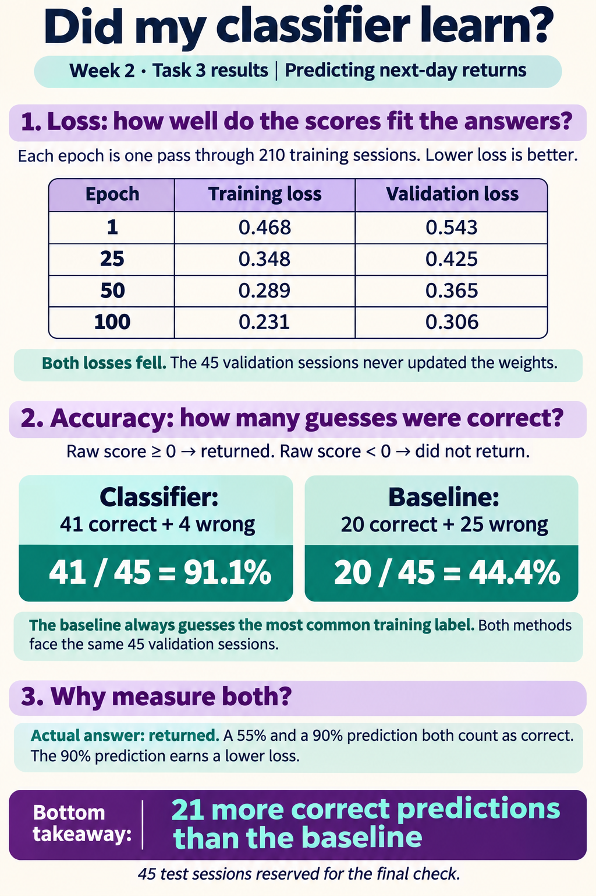
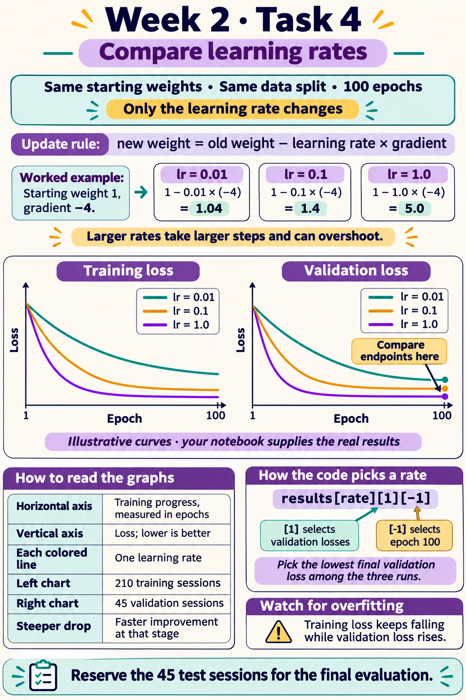

# Modelcraft Lab

Hands-on notebooks for the [AI Roadmap](https://airoadmap-taupe.vercel.app/#roadmap). Start with a dot product in NumPy, then use the same idea in PyTorch to turn an app session into four scores.

| Lab | What you’ll do |
| --- | --- |
| [Week 1 · NumPy and training math](notebooks/week01_numpy.ipynb) | Compare Python and NumPy matrix multiplication, summarize app launch times, and see how the learning rate changes a gradient descent step. |
| [Week 2 · Your first forward pass](notebooks/week02_tensors.ipynb) | Pass two sessions through the same weights and biases. Predict the second row of output, then run the cell to check it. |
| [Week 2 · Train a classifier](notebooks/week02_classifier.ipynb) | Train a model on simulated app sessions, compare it with a baseline, and plot loss curves for three learning rates. |

## Run the notebooks

Install [uv](https://docs.astral.sh/uv/getting-started/installation/), then run the following commands. The lab uses Python 3.12.

```bash
git clone --branch branchx https://github.com/ytubeprakash-cyber/AiRoadMap.git
cd AiRoadMap
uv sync --locked
uv run --locked pytest
uv run --locked --with torch --with matplotlib jupyter lab
```

The last command includes PyTorch and Matplotlib for Week 2. In JupyterLab, open a notebook from the table above, select the project’s Python kernel, and choose **Kernel → Restart Kernel and Run All Cells**.

## Week 2 · From session data to four scores

Each row of `X` holds three measurements in order: minutes in the app, screens visited, and clicks. Each column of `W` supplies the weights for one score. With two sessions and four scores, `X @ W` has shape `(2, 4)`. Adding `bias` adds the same four values to each row.

| Session input | Weighted sums (`X @ W`) | After adding `[10, 20, 30, 40]` |
| --- | --- | --- |
| `[1, 2, 3]` | `[1, 2, 3, 6]` | `[11, 22, 33, 46]` |
| `[4, 5, 6]` | `[4, 5, 6, 15]` | `[14, 25, 36, 55]` |

Follow the fourth column in the infographic. All three weights are 1, so the second session’s fourth score is `4 + 5 + 6 + 40 = 55`.



## Week 2 Task 2 — Let PyTorch compute the gradient

Think of `w` as a slider starting at 1. To estimate the slope of `loss = (w - 3) ** 2`, try two nearby settings while keeping the original weight at 1. With `epsilon = 0.001`, those settings are 0.999 and 1.001. They are **two tiny steps apart**, so the denominator is `2 * epsilon`.

Going from left to right, the loss falls by 0.008 while the weight increases by 0.002. Their ratio is −4, the same gradient PyTorch puts in `w.grad` after `loss.backward()`. With a learning rate of 0.1, the next weight is 1.4 and the loss falls from 4.00 to 2.56.



## Week 2 Task 3 — Train your first classifier

Will a user return tomorrow? Follow one session through the infographic. The green card shows how the synthetic dataset gets its answer. The orange card shows the model’s guess using example starting weights. The model sees the session and its label during training. It has to learn its own weights.

![Worked classifier example. For the session [1, 0, −1], the hidden rule gives label 1, while the model scores it −0.2 and predicts 0. The training loop uses the average loss across 210 sessions to update three weights and a bias.](docs/images/week02-task03-classifier.png)

**What changes on the next pass?** The session and its correct label stay the same. Task 1’s forward pass gives a score. Task 2’s gradients tell the optimizer how to adjust each weight and the bias. Next time the model sees that session, the updated weights can give it a different score.

**How do you check progress?** Compare training loss at epochs 1 and 100. Then check whether the model predicts the 45 validation labels more accurately than always guessing the most common training label. Save the 45 test sessions for the final evaluation.

### Did my classifier learn?

Validation loss fell from 0.543 to 0.306. On the same 45 validation sessions, the classifier made 41 correct predictions and the majority-label baseline made 20.



## Week 2 Task 4 — Compare learning rates

Train fresh models with learning rates of 0.01, 0.1, and 1.0. Give every run the same data split, starting weights, and 100 epochs. Record training and validation losses after each update, then select the rate with the lowest validation loss at epoch 100.

The infographic uses illustrative curves to explain the axes, colors, and endpoint comparison. Use the notebook’s measured curves to choose your rate.



## Week 1 · Check your results

- **Matrix multiplication.** Compare the Python loop and NumPy outputs before comparing their timings. Benchmark times vary by machine.
- **Launch times.** The sample has a mean of 200 ms and a population variance of 5,000 ms². Of the observed launches, 40% took longer than 200 ms.
- **Gradient descent.** Starting from a loss of 4.00, one update at a learning rate of 0.1 brings it down to 2.56. Try 1.1 and watch the step overshoot, raising the loss to 5.76.

The [linear algebra helpers](src/modelcraft_lab/linalg.py) and [JSONL utilities](src/modelcraft_lab/jsonl.py) have [tests](tests/). Use the [sample JSONL file](data/sample.jsonl) to practice reading one record at a time.
